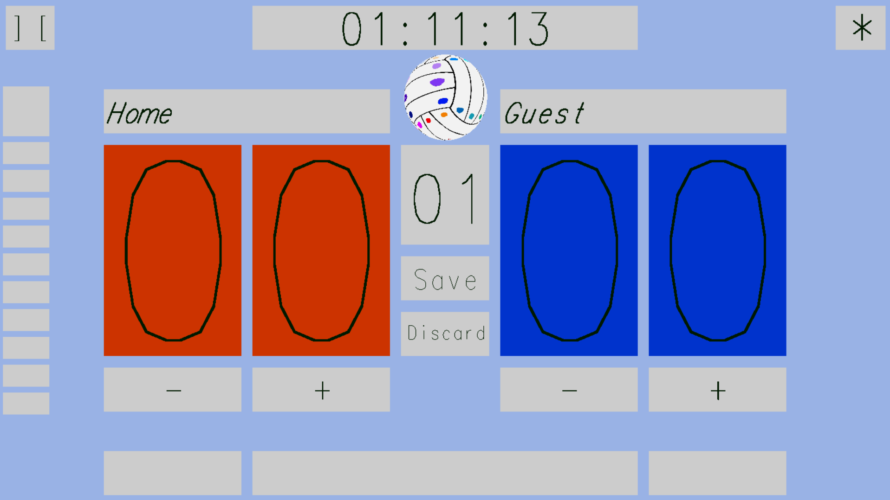

# Scoreboard program

A program designed to keep track of scores for games like volleyball, basketball, and ping pong.

You can find concept art for the interface design in concept_art.png which shows a rough sketch of the planned features.

## Technical details
* C++
* OpenGL 4.4.0
* freeGLUT
* ctime
* stb_image.h https://github.com/nothings/stb/blob/master/stb_image.h

## Build instructions for Windows 10 using VSCode

You will need MinGW and freeglut and then you must tell VSCode where to look for the libraries using a .vscode folder and subsequent files.

## Current features
* Current time of day updated every second
* Display scores between 00 and 99 for two teams
* Draw boxes using pixel coordinates
* Print text on the screen for team names and buttons
* Buttons to add or subtract a point from each team's score
* Team names can be edited
* Set number can be edited
* Window can be resized to users needs
* Window can be full screen or windowed
* Sphere with a volleyball texture displayes and rotates

## Screenshots

## Sources and attributions:
* Thank you to Lighthouse3d for the introductive tutorials to help me check my framework setup.
* I used some of the code from this tutorial:
* http://www.lighthouse3d.com/tutorials/glut-tutorial/preparing-the-window-for-a-reshape/

* Also a thank you to this tutorial for various glut things like fullscreen mode
* https://www3.ntu.edu.sg/home/ehchua/programming/opengl/cg_introduction.html

* I also used code or suggestions from these stackoverflow questions and answers:
* https://stackoverflow.com/questions/27276075/glut-mouse-button-down
* https://stackoverflow.com/questions/24872986/error-a-pointer-to-a-bound-function-may-only-be-used-to-call-the-function
* https://stackoverflow.com/questions/3032386/glgenbuffers-not-defined
* https://stackoverflow.com/questions/19102180/how-does-gldrawarrays-know-what-to-draw

